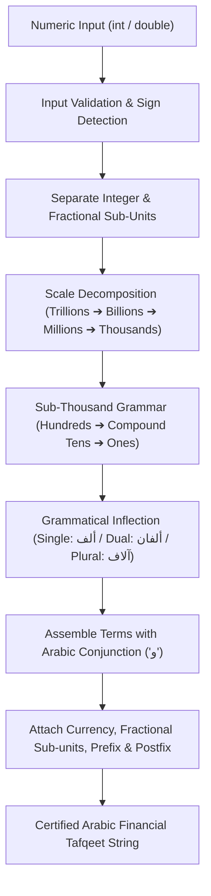

# 🔠 arabic-tafqeet-dart

> **Topics:** `tafqeet` `arabic` `dart` `flutter` `numbers-to-words` `invoicing` `arabic-grammar`


[](https://github.com/MobileConduit/arabic-tafqeet-dart/releases/tag/v1.0.0)
[](https://github.com/MobileConduit/arabic-tafqeet-dart/actions/workflows/ci.yml)
[](LICENSE)
[](https://dart.dev)
[](https://github.com/MobileConduit)
[](https://github.com/MobileConduit)

A pure Dart library converting numerical currencies and numbers into formal, grammatically accurate Arabic textual spelling (تفقيط الأرقام والمبالغ) tailored for billing, ERPs, banking, and financial invoicing apps across Flutter and Dart platforms.

---

## 🏛 Architecture & Conversion Workflow



---

## 🌟 Key Features

- **Grammatically Accurate Arabic Numbers**: Precise handling of single (مفرد), dual (مثنى), and plural (جمع) forms for thousands, millions, billions, and trillions.
- **Support for Huge Scales**: Numbers up to trillions supported seamlessly.
- **Fractional / Decimal Currency Support**: Converts decimals into designated sub-units (e.g., هللة, قرش, سنت) via `convertDouble`.
- **Customizable Prefixes & Suffixes**: Flexible support for traditional banking terminology (`فقط`, `لا غير`, `المبلغ المحسوب:`).
- **Interactive CLI Included**: Ready-to-use command-line utility in `bin/arabic_tafqeet.dart`.
- **Zero External Runtime Dependencies**: Pure Dart implementation compatible with web, desktop, and mobile Flutter apps.

---

---

## ⚙️ Installation & Setup

```bash
git clone https://github.com/MobileConduit/arabic-tafqeet-dart.git
cd arabic-tafqeet-dart
dart pub get
```

## 📦 Dart / Flutter Usage

### 1. Basic Currency Conversion
```dart
import 'package:arabic_tafqeet/arabic_tafqeet.dart';

void main() {
  String text = ArabicTafqeet.convert(15420, currency: "ليرة سورية");
  print(text);
  // Output: فقط خمسة عشر ألف و أربعمائة و عشرون ليرة سورية لا غير
}
```

### 2. Large Numbers (Millions & Billions)
```dart
String millions = ArabicTafqeet.convert(
  2500000, 
  currency: "ريال سعودي"
);
print(millions);
// Output: فقط مليونان و خمسمائة ألف ريال سعودي لا غير
```

### 3. Decimal Amounts with Sub-units (Halalas, Cents)
```dart
String withCents = ArabicTafqeet.convertDouble(
  150.75,
  currency: "ريال سعودي",
  subUnit: "هللة",
  precision: 2,
);
print(withCents);
// Output: فقط مائة و خمسون ريال سعودي و خمسة و سبعون هللة لا غير
```

### 4. Raw Number-to-Words (Without Currency Affixes)
```dart
String rawWords = ArabicTafqeet.convertNumber(1250);
print(rawWords);
// Output: ألف و مائتان و خمسون
```

---

## 💻 Command Line Interface (CLI)

Run the CLI tool directly from terminal:

```bash
# Basic conversion
dart run bin/arabic_tafqeet.dart 15420

# With specific currency
dart run bin/arabic_tafqeet.dart 2500000 --currency "ريال سعودي"

# Decimal amount with sub-units
dart run bin/arabic_tafqeet.dart 1250.75 --currency "دولار أمريكي" --sub-unit "سنت"
```

---

## ⚙️ Configuration (.env)

A `.env.example` file is included for specifying default application-wide currency preferences:
```bash
cp .env.example .env
```

Available keys:
- `DEFAULT_CURRENCY`: Default primary currency (e.g. `ليرة سورية`).
- `DEFAULT_SUB_CURRENCY`: Default sub-unit currency (e.g. `قرش`).
- `DEFAULT_PREFIX`: Default prefix wording (`فقط`).
- `DEFAULT_POSTFIX`: Default postfix wording (`لا غير`).

---

## 🧪 Running Automated Tests

Run the full automated test suite verifying edge cases across grammar rules:

```bash
dart test
```

---

## 👤 Author & Maintainer

**Eng. MHD. Shadi AL-Hasan**  
- **Role:** Executive CTO & Enterprise Solutions Architect  
- **Email:** [mhd.shadi.alhasan@gmail.com](mailto:mhd.shadi.alhasan@gmail.com)  
- **Phone / WhatsApp:** [+963934005922](tel:+963934005922)  
- **Location:** Damascus, Syria  
- **GitHub:** [MobileConduit](https://github.com/MobileConduit)  

---

## 📄 License

This project is licensed under the MIT License - see the [LICENSE](LICENSE) file for details.  
Copyright (c) 2026 **MHD. Shadi AL-Hasan**. All rights reserved.